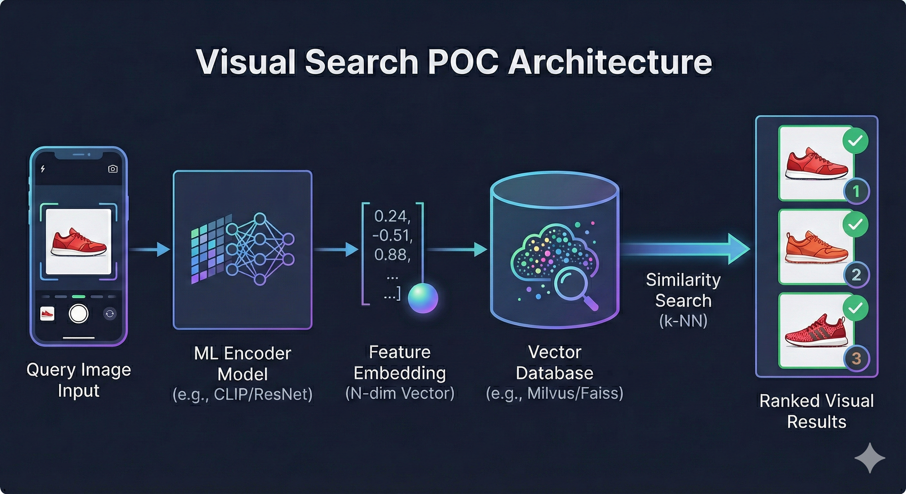

# Visual Search System POC (SOP Benchmark)

A demonstration-grade visual search system (Pinterest-style) that retrieves and ranks images visually similar to a query image (optionally a crop/ROI in later milestones). This POC includes:

- **End-to-end visual search**: query image → embedding → ANN retrieval → exact rerank → results
- **Offline evaluation** on a standard retrieval benchmark (Stanford Online Products / SOP): **Recall@K**, **mAP@K**, **nDCG@K**
- **Online instrumentation** (demo-scale): impressions + clicks → **CTR@K**

This README is written as a combined **system design document + runbook** to reproduce, test, and demo the POC.

---

## 1) System at a glance

### Problem statement
Given a query image, return a ranked list of the most visually similar images from a gallery. The primary ranking signal is **distance/similarity in embedding space**.

### Solution approach (representation learning + retrieval)
1. Convert each image into a fixed-length **embedding vector**
2. Store all gallery embeddings in an **Approximate Nearest Neighbor (ANN)** index
3. For a query:
   - compute query embedding
   - retrieve Top-K′ candidates with ANN
   - **rerank** candidates with exact cosine similarity
   - return Top-K results

---

## 2) Architecture

### High-level services
- **Indexing pipeline (offline / batch)**
  - Ingest gallery images → compute embeddings → build ANN index → persist artifacts
- **Prediction pipeline (online / serving)**
  - Upload query image → compute embedding → ANN retrieve → rerank → return results
- **UI (demo)**
  - Upload image and display ranked results; emit click events for CTR measurement

### Data flow

**Indexing pipeline**
```
Gallery Images -> Metadata DB -> Embeddings (.f32 + id_map.json) -> ANN Index (hnsw.bin)
```

**Prediction pipeline**
```
Query Image -> Preprocess -> Embedding -> ANN Top-K' -> Exact Rerank -> Results
                                              |
                                              +--> (optional) dedup / rerank policies
```

---

## 3) Repository layout (expected)

> If your tree differs slightly, adjust paths in configs accordingly.

```
visual-search/
  app/
    main.py
    api.py
    config.py
    embedding_service.py
    index_service.py
    interaction_store.py          # (for impressions/clicks -> CTR)
    schemas.py
    utils.py
  ui/
    app.py                        # Streamlit demo UI
  scripts/
    prepare_sop_subset.py
    materialize_split_dir.py
    ingest_images.py
    embed_images.py
    build_index.py
    eval_sop_retrieval.py
    compute_ctr.py
  configs/
    default.yaml
    sop_gallery.yaml
  data/
    sop_poc/
      images/
      manifests/
      query/
      gallery/
  artifacts/
    metadata/
    embeddings/
    index/
```

---

## 4) POC milestones

### Milestone A — E2E retrieval (baseline)
- Embeddings from a pretrained image model (e.g., OpenCLIP)
- ANN index (HNSW) for retrieval
- Exact cosine rerank for final ordering

### Milestone B — Demo quality + metrics
- **Rerank + (optional) dedup** for cleaner results
- **Offline metrics** on SOP: Recall@K, mAP@K, nDCG@K
- **Online metrics** (demo): CTR@K computed from impression/click logs

### Milestone C (future)
- Crop/ROI queries (Pinterest-style “search within image”)
- Click-based fine-tuning / metric learning
- Hard negative mining, improved reranking, and better ANN configs

---

## 5) Dataset: Stanford Online Products (SOP)

This POC uses **SOP** because it is a standard metric-learning / retrieval benchmark with train/test splits.

### What we prepared
We created a POC subset and split manifests:

- `data/sop_poc/manifests/train.csv`
- `data/sop_poc/manifests/query.csv`
- `data/sop_poc/manifests/gallery.csv`

Example subset stats (from a completed run):
- Train rows: **1755**
- Test rows (query/gallery): **1692**

### Dataset preparation (already done in your run)
If you ever need to reproduce:

```bash
python scripts/prepare_sop_subset.py \
  --sop_root /path/to/Stanford_Online_Products \
  --out_dir data/sop_poc \
  --mode symlink \
  --seed 13 \
  --max_superclasses 5 \
  --max_classes_per_super 120 \
  --min_images_per_class 3 \
  --max_images_per_class 10
```

Materialize query/gallery directories for clean evaluation:

```bash
python scripts/materialize_split_dir.py \
  --images_root data/sop_poc/images \
  --manifest_csv data/sop_poc/manifests/gallery.csv \
  --out_dir data/sop_poc/gallery \
  --mode symlink

python scripts/materialize_split_dir.py \
  --images_root data/sop_poc/images \
  --manifest_csv data/sop_poc/manifests/query.csv \
  --out_dir data/sop_poc/query \
  --mode symlink
```

---

## 6) Configuration

### SOP gallery config (recommended)
Create `configs/sop_gallery.yaml`:

```yaml
data:
  image_dir: "data/sop_poc/gallery"
  sqlite_path: "artifacts/metadata/sop_gallery.sqlite"
  allowed_ext: [".jpg", ".jpeg", ".png", ".webp"]

artifacts:
  root_dir: "artifacts"

model:
  model_version: "openclip_vitb32_v1"
  backbone: "ViT-B-32"
  pretrained: "laion2b_s34b_b79k"
  device: "auto"

preprocess:
  preprocess_version: "openclip_default_v1"

index:
  index_version: "hnsw_sop_gallery_v1"
  space: "cosine"
  ef_construction: 200
  M: 32
  ef_search: 64
  top_k: 50
  top_k_candidates: 200

# Optional; some codebases parse this, others ignore it.
dedup:
  enabled: true
  similarity_threshold: 0.995

# Recommended: disable for SOP benchmark unless demoing CTR
tracking:
  enabled: false
```

Notes:
- `top_k_candidates` is K′ for ANN retrieval; `top_k` is the final returned list size.
- `ef_search` impacts recall/latency at query time.
- `dedup` may be optional depending on your `AppConfig` version; the evaluation script can be made config-agnostic.

---

## 7) Build artifacts (indexing pipeline)

Run once per dataset/config:

```bash
python scripts/ingest_images.py --config configs/sop_gallery.yaml
python scripts/embed_images.py  --config configs/sop_gallery.yaml
python scripts/build_index.py   --config configs/sop_gallery.yaml
```

Expected artifacts:
- `artifacts/metadata/sop_gallery.sqlite`
- `artifacts/embeddings/<model>/<preprocess>/embeddings.f32`
- `artifacts/embeddings/<model>/<preprocess>/id_map.json`
- `artifacts/index/<model>/<preprocess>/<index_version>/hnsw.bin`
- `artifacts/index/<model>/<preprocess>/<index_version>/index_meta.json`

---

## 8) Run the POC (serving + UI)

### 8.1 Start the API
```bash
uvicorn app.main:app --host 0.0.0.0 --port 8000
```

### 8.2 Start the UI (Streamlit)
```bash
streamlit run ui/app.py
```

**Demo flow**
1. Upload a query image (recommend: pick from `data/sop_poc/query/…`)
2. System returns Top-K results (gallery images), sorted by similarity
3. Click a few results (logs clicks if tracking enabled)

---

## 9) Offline evaluation (SOP benchmark)

Run evaluation against the built SOP gallery index:

```bash
python scripts/eval_sop_retrieval.py \
  --config configs/sop_gallery.yaml \
  --k 50 \
  --k_candidates 200 \
  --max_queries 500
```

### Metrics
- **Recall@K**: fraction of relevant items retrieved within top K
- **mAP@K**: ranking-sensitive; rewards relevant items appearing early
- **nDCG@K**: discounted cumulative gain normalized by ideal ranking; strong for ranking quality

### Example baseline results (completed run)
```
Queries evaluated: 500
Recall@50: 0.7754
mAP@50:   0.5830
nDCG@50:  0.7189
```

### Common evaluation gotcha: `cfg.dedup` missing
Some versions of `AppConfig` do not include a `dedup` section. If you see:
`AttributeError: 'AppConfig' object has no attribute 'dedup'`

Use the evaluation script’s “signature-safe” initialization (or remove `cfg.dedup.*` references). The recommended pattern is to detect optional constructor parameters using `inspect.signature`.

---

## 10) Online metrics (CTR for demo)

CTR is computed from **impressions** and **click** logs.

### 10.1 Enable tracking
Set in a demo config (example: `configs/sop_demo.yaml`):

```yaml
tracking:
  enabled: true

data:
  sqlite_path: "artifacts/metadata/sop_demo.sqlite"
```

> Use a separate SQLite file for demo to avoid mixing benchmark runs and interactive logs.

Start API/UI with this config (depending on how your app chooses config):
- if your app uses `CONFIG_PATH` env var:
  ```bash
  export CONFIG_PATH=configs/sop_demo.yaml
  uvicorn app.main:app --reload
  ```
- if your app reads config from CLI, pass `--config` accordingly.

### 10.2 Log impressions and clicks
- `/search` should write **impressions**: one row per returned item with its position.
- `/click` should write **click** events.

### 10.3 Compute CTR@K
```bash
python scripts/compute_ctr.py --config configs/sop_demo.yaml --k 50 --since_hours 24
```

Example output:
```
Window: last 24 hours
Impressions@50: 1500
Clicks@50:      45
Item CTR@50:    0.0300
Searches:       30
Search CTR@50:  0.6000
```

Interpretation:
- **Item CTR@K**: clicks / impressions among top-K displayed items
- **Search CTR@K**: fraction of searches that got ≥1 click within top-K

---

## 11) API endpoints (expected)

### `POST /search`
- Input: image file (`multipart/form-data`)
- Output: ranked results with `image_id`, `uri`, `score`, `position`
- Side effects (if tracking enabled): write impression logs

### `POST /click`
- Input JSON:
  ```json
  {
    "search_id": "uuid",
    "query_sha256": "hex",
    "image_id": "hex",
    "position": 1
  }
  ```
- Side effects (if tracking enabled): write click logs

---

## 12) Testing / smoke checks

### 12.1 Index artifacts exist
```bash
ls artifacts/index
ls artifacts/embeddings
```

### 12.2 Quick search from CLI (optional)
If you have a small client script or curl supports your API:

```bash
curl -X POST "http://localhost:8000/search?top_k=20&top_k_candidates=200" \
  -F "file=@data/sop_poc/query/<some_image>.jpg"
```

### 12.3 Verify impressions/clicks are logged (SQLite)
```bash
sqlite3 artifacts/metadata/sop_demo.sqlite \
  "select event_type, count(*) from interactions group by event_type;"
```

---

## 13) Performance knobs (for demo reliability)

- **top_k_candidates (K′)**: 200 → 500 improves quality (at cost of compute)
- **ef_search**: 64 → 128 improves ANN recall and final ranking
- **dedup_similarity_threshold**: 0.995 is conservative; lower filters more aggressively

For a smooth demo:
- Use `top_k=50`, `top_k_candidates=200`, `ef_search=64` initially.
- If latency is high, reduce K′.

---

## 14) Troubleshooting

### Issue: `AttributeError: AppConfig has no attribute dedup`
- Fix: make scripts tolerant to missing config sections OR update `app/config.py` to include `dedup`.

### Issue: CTR shows 0 impressions
- Ensure `/search` is logging impressions.
- Ensure `tracking.enabled: true` and DB path points to a writable location.

### Issue: clicks are not logged
- Ensure UI calls `/click` with correct payload fields.
- Ensure `search_id` is returned by `/search` and propagated to `/click`.

### Issue: missing images during evaluation
- Confirm `data/sop_poc/query/` and `data/sop_poc/gallery/` were materialized correctly
- Verify `rel_path` values match the directory structure under `data/sop_poc/images/`

---

## 15) Roadmap (post-demo)

1. **ROI/crop search**: user selects region; embed crop; retrieve
2. **Click-based training**: use click pairs as positives; sample hard negatives from ANN
3. **Reranking model**: lightweight MLP or cross-attention reranker for top-200
4. **Better ANN**: FAISS IVF/PQ or ScaNN, quantization, sharding

---

## 16) References (optional)

If you need dataset sources, keep URLs in code blocks to avoid markdown-link noise:

```text
Stanford Online Products (SOP):
- Search: "Stanford Online Products dataset"
- Files: Ebay_train.txt, Ebay_test.txt, images/

DeepFashion In-shop:
- Search: "DeepFashion In-shop Clothes Retrieval Benchmark"
```

---

## Quick demo script (copy/paste)

```bash
# 0) Ensure query/gallery directories exist
python scripts/materialize_split_dir.py \
  --images_root data/sop_poc/images \
  --manifest_csv data/sop_poc/manifests/gallery.csv \
  --out_dir data/sop_poc/gallery \
  --mode symlink

python scripts/materialize_split_dir.py \
  --images_root data/sop_poc/images \
  --manifest_csv data/sop_poc/manifests/query.csv \
  --out_dir data/sop_poc/query \
  --mode symlink

# 1) Build gallery index (one-time)
python scripts/ingest_images.py --config configs/sop_gallery.yaml
python scripts/embed_images.py  --config configs/sop_gallery.yaml
python scripts/build_index.py   --config configs/sop_gallery.yaml

# 2) Offline evaluation
python scripts/eval_sop_retrieval.py --config configs/sop_gallery.yaml --k 50 --k_candidates 200 --max_queries 500

# 3) Run API + UI for demo (use sop_demo.yaml if tracking enabled)
uvicorn app.main:app --host 0.0.0.0 --port 8000
# in another terminal:
streamlit run ui/app.py

# 4) After interacting in UI:
python scripts/compute_ctr.py --config configs/sop_demo.yaml --k 50 --since_hours 24
```
