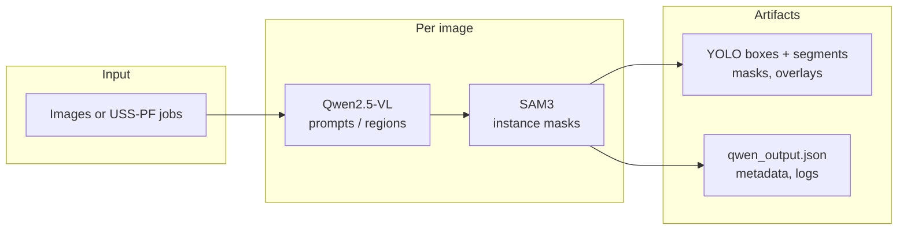
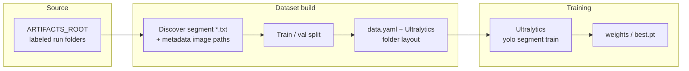
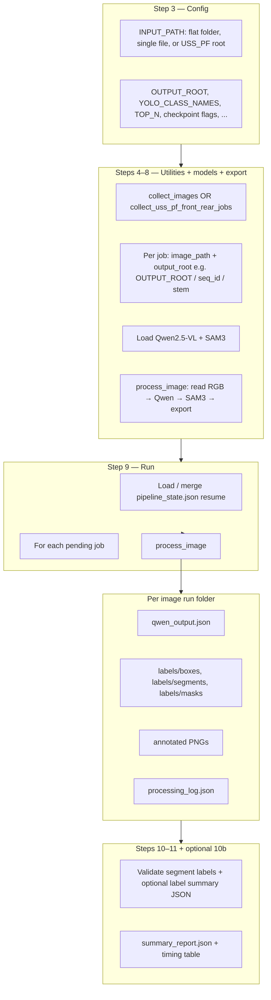
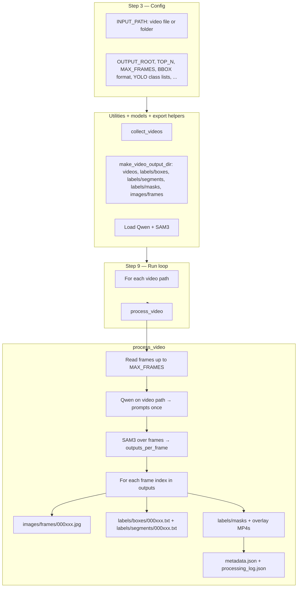

# Auto-labeler pipeline overview

Logic maps for the **image** notebook, **video** notebook, and **YOLO-seg training** notebook. Render Mermaid in GitHub, VS Code / Cursor (Markdown preview), or any Mermaid-compatible viewer.

Related notebooks:

- `qwen_sam3_image_pipeline.ipynb`
- `qwen_sam3_pipeline_video.ipynb`
- `train_yolo_seg_from_image_pipeline.ipynb`
- `mine_qwen_taxonomy.ipynb` (optional: mine Qwen prompts from existing runs to grow `YOLO_CLASS_NAMES`)

---

## Expanding the closed set (Option A)

To add **new YOLO classes** instead of relying on open vocabulary alone:

1. Run **`mine_qwen_taxonomy.ipynb`** on an `ARTIFACTS_ROOT` that already contains runs with **`qwen_output.json`** (same tree as image/video outputs). It prints prompt frequencies, flags strings that do not map to your current `YOLO_CLASS_NAMES` / `YOLO_CLASS_ALIASES`, and can write **`mine_taxonomy_report.json`** for review.
2. Edit **Step 3** in `qwen_sam3_image_pipeline.ipynb` (and the video notebook’s matching class list / aliases) so **`nc`**, names, and aliases cover the taxonomy you want; merge near-duplicates with aliases rather than inflating `nc` blindly.
3. **Re-run** the image (and/or video) labeling pipeline so **`labels/segments/*.txt`**, **`classes.txt`**, and **`metadata.json`** are regenerated with the new class indices. Old segment files stay on the old index scheme until you re-export.
4. Rebuild the training dataset and **retrain** with `train_yolo_seg_from_image_pipeline.ipynb` (or point training at a fresh `DATASET_ROOT`).

---

## End-to-end relationship

```text
                    ┌─────────────────┐
  images/videos ──► │  Qwen (prompts) │   slow: vision–language + text decode
                    └────────┬────────┘
                             │
                    ┌────────▼────────┐
                    │ SAM3 (masks)   │   faster: vision + mask heads
                    └────────┬────────┘
                             │
              ┌──────────────┴──────────────┐
              ▼                             ▼
   Image / video notebooks          train_yolo_seg_from_image_pipeline.ipynb
   write labels/segments +           reads artifact folders + metadata.json
   metadata.json                    → Ultralytics dataset + `yolo segment train`
```

---

## High-level diagrams

Two separate flows: **labeling** (Qwen + SAM3 in the image notebook) vs **training** (dataset build + Ultralytics only; no VL/segmentation models).

### Image labeling pipeline



### YOLO training pipeline (separate)



*The detailed step-by-step Mermaid charts for each notebook are in the sections below.*

---

## 1. Image pipeline (`qwen_sam3_image_pipeline.ipynb`)



**Summary:** one **VL pass (Qwen)** for prompts, one **segmentation pass (SAM3)** per image, then **YOLO-style exports**; optional **JSON state** for resume (`pipeline_state.json`).

---

## 2. Video pipeline (`qwen_sam3_pipeline_video.ipynb`)



**Summary:** **Qwen once per clip** (prompts), **SAM3 per frame**, then **aligned stems** `000123.jpg` ↔ `000123.txt` for YOLO-seg-style training exports.

---

## 3. YOLO-seg training (`train_yolo_seg_from_image_pipeline.ipynb`)

```mermaid
flowchart TD
  subgraph cfg["Config"]
    T1[ARTIFACTS_ROOT e.g. outputs/uss_pf or outputs/images]
    T2[DATASET_ROOT, DEVICE auto/cuda/mps/cpu, DRY_RUN, train hyperparams]
  end

  subgraph scan["Discover pairs"]
    S1[Walk flat or nested run dirs with labels/segments]
    S2[Segment *.txt + labels/metadata.json → field image]
    S3[Skip empty labels, missing images, inconsistent class lists]
  end

  subgraph split["Train / val split"]
    L1[sequence groups or random per image]
  end

  subgraph mat["Materialize Ultralytics layout"]
    M1[Symlink or copy into images/train, images/val, labels/train, labels/val]
    M2[Same stem for each image + label pair]
    M3[Write data.yaml: path, train, val, nc, names]
  end

  subgraph train["Train optional"]
    U1[resolve_training_device]
    U2[YOLO(weights).train(data, epochs, imgsz, batch, device, project, name)]
    U3[weights/best.pt under project/name]
  end

  cfg --> scan --> split --> mat
  mat --> train
```

**Summary:** **no Qwen/SAM3** — only **scanning artifacts**, **pairing** label files with `metadata.json["image"]`, building **`data.yaml`**, then **Ultralytics** `yolo segment train`.

---

## File reference

| Artifact | Typical location |
|----------|------------------|
| Image run (flat) | `OUTPUT_ROOT/<image_stem>/` |
| Image run (USS-PF) | `OUTPUT_ROOT/<seq_id>/<image_stem>/` |
| Video run | `OUTPUT_ROOT/<video_stem>/` |
| Segment labels | `.../labels/segments/<stem>.txt` |
| Source image pointer | `.../labels/metadata.json` → `"image"` |
| Training dataset | `DATASET_ROOT/images/{train,val}/`, `labels/{train,val}/`, `data.yaml` |
| Training runs | `PROJECT/NAME/weights/best.pt` |

---

*Generated for the visual-search `auto-labeler` workflows.*
